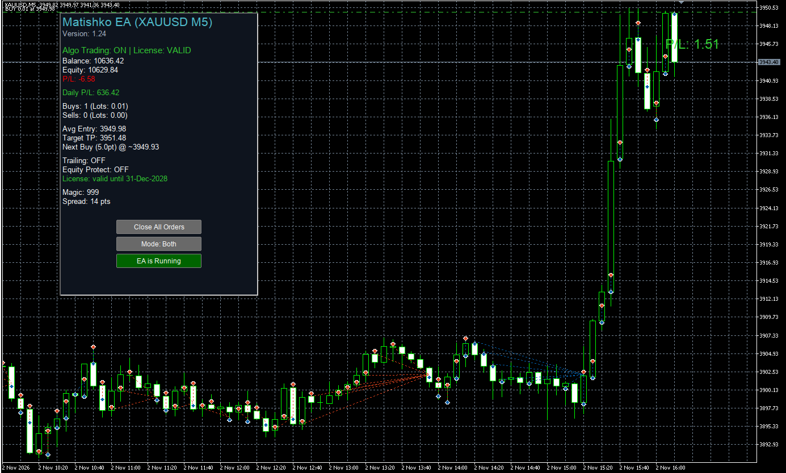

# Matishko EA

**Martingale-based grid Expert Advisor for MetaTrader 4 and MetaTrader 5**

Matishko EA manages trades as a basket using configurable grid entries, progressive position sizing, and a volume-weighted average take-profit target. It is designed to complement an independent directional strategy;

## Downloads

**Latest release: v1.25**

| Platform | Download |
|---|---|
| MetaTrader 4 | [Matishko_EA_v1.25.ex4](https://github.com/kzlca/Matishko-EA/releases/download/v1.25/Matishko_EA_v1.25.ex4) |
| MetaTrader 5 | [Matishko_EA_v1.25.ex5](https://github.com/kzlca/Matishko-EA/releases/download/v1.25/Matishko_EA_v1.25.ex5) |

See the [v1.25 release manifest](docs/RELEASE-v1.25.md) for file sizes and SHA-256 checksums.

## Recommended operating approach

Matishko EA is intended to manage a basket after a trader or an independent strategy identifies a possible directional opportunity.

- **Bullish directional signal:** select `Buy Only`.
- **Bearish directional signal:** select `Sell Only`.
- **Ranging Market:** select `Both Mode`. 
- **No signal:** pause `EA`.

If the initial entry moves against the basket and price later reverses sufficiently, the changed volume-weighted average entry may allow the basket to reach its take-profit target. This is a possible recovery mechanism, not a guarantee. Continued adverse movement can increase exposure and floating losses significantly.

## Panel controls

- **Pause / resume:** Click the `EA is Running` button to pause the EA; it changes to `EA stopped`. Click it again to resume. Pausing does not close open positions. It suspends the EA's own tick-based processing while paused, including new grid entries and updates to its trailing-stop and equity-protection actions. Open positions remain exposed to market risk; pause is not a close-all or protective-exit command.
- **Reposition buttons:** The `Close All Orders`, direction, and EA state buttons are selectable chart objects. Select and drag each button to move it to a different position on the chart. The panel background and information labels are not moved with the buttons.

## Strategy Tester and parameter selection

**The shipped input defaults are reference starting values, not backtested or optimized recommendations.** They have not been established through a systematic historical backtest or broker-specific forward test. Do not assume they are suitable for your symbol, timeframe, broker, account size, or risk tolerance.

Use the MetaTrader Strategy Tester to evaluate and optimize your own settings. Test realistic historical data, spreads, commissions, swaps, leverage, and margin conditions. Use separate historical periods for optimization and out-of-sample validation, then forward-test the selected configuration on a demo account.

For a Martingale grid, evaluate maximum equity drawdown, margin usage, largest basket exposure, and time spent in floating loss—not just net profit or profit factor.

Read the [Strategy Testing and Optimization Guide](docs/STRATEGY-TESTING.md) and [Input parameters](docs/INPUT-PARAMETERS.md) before selecting settings.

## Platform compatibility

- **MetaTrader 4:** use the `.ex4` release asset.
- **MetaTrader 5:** use the `.ex5` release asset and an MT5 **hedging account**. Netting accounts are not supported by this multi-position strategy.

## Installation

1. Download the binary for your platform from the [v1.25 release](https://github.com/kzlca/Matishko-EA/releases/tag/v1.25).
2. In MetaTrader, choose **File → Open Data Folder**.
3. For MT4, copy the `.ex4` file into `MQL4/Experts/`. For MT5, copy the `.ex5` file into `MQL5/Experts/` (or a subfolder).
4. Refresh the Expert Advisors list in Navigator or restart the terminal.
5. Attach Matishko EA to a chart and review all inputs, including `TradeDirection`.
6. Test the exact build on a demo account before considering live use.

See the [installation guide](docs/INSTALLATION.md).

## Risk information

Matishko EA uses a Martingale-based grid approach. Position volume can grow geometrically as additional entries are added. A prolonged move against the basket can produce substantial floating losses, increasing margin usage and potentially causing stop-out or loss of the trading balance.

Trailing stops, basket take-profit, maximum-position limits, and equity protection do not eliminate market, liquidity, execution, or platform risk. No profitability or capital-protection guarantee is made. Read [Risk and limitations](docs/RISK-AND-LIMITATIONS.md) before use.

## Proprietary software

Matishko EA is proprietary software. The `.mq4` and `.mq5` source files are not included in this public repository or release assets. Only the compiled platform binaries and user documentation are distributed.

## Support

For reproducible installation problems or software defects, open a [GitHub Issue](https://github.com/kzlca/Matishko-EA/issues). Do not include account numbers, passwords, investor credentials, or other sensitive information.
